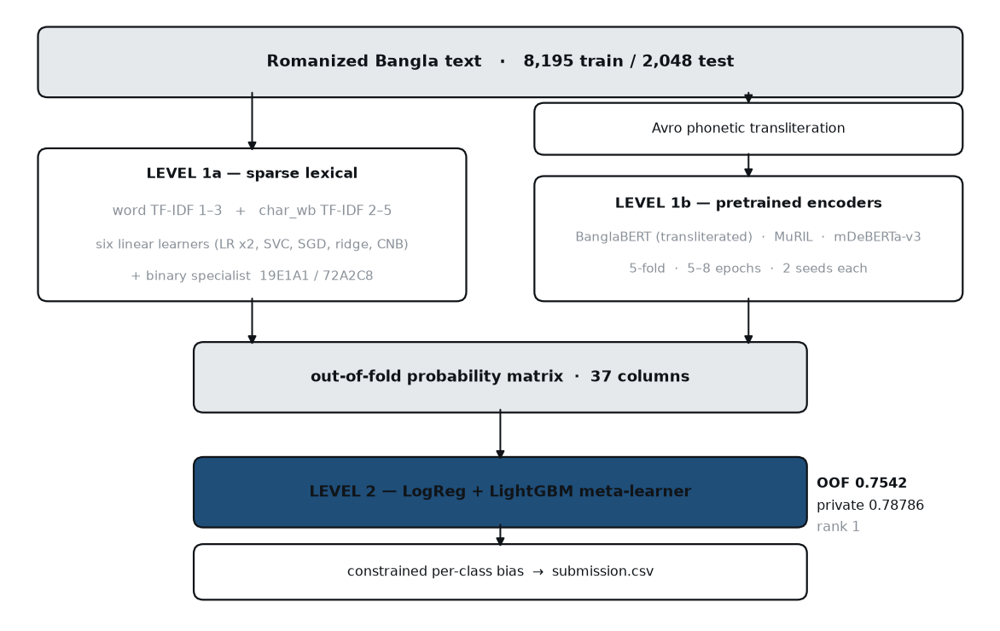
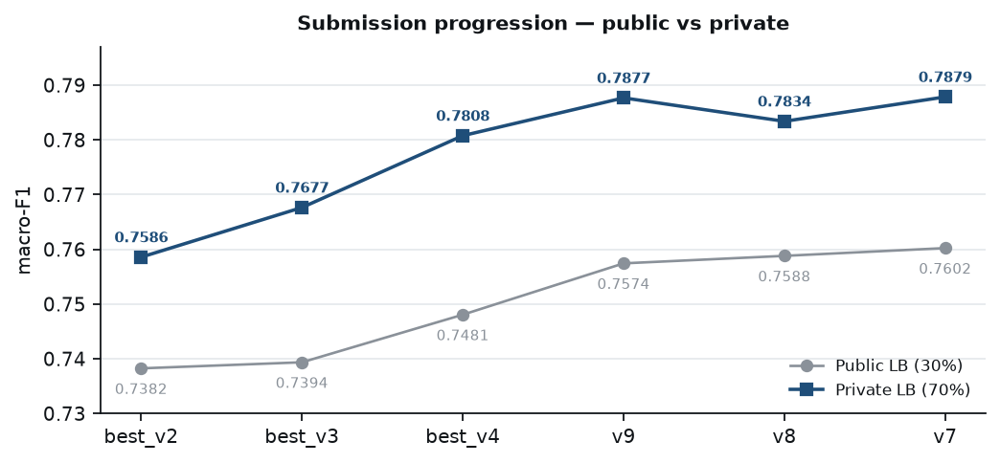
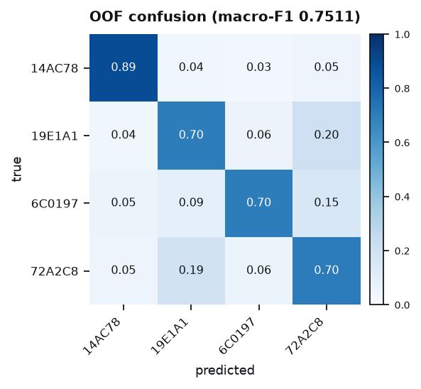

# BhasaQuest-1 — 1st Place Solution

**Four-class classification of romanized Bangla text** · Kaggle competition, metric = macro-F1

| Private LB | Public LB | Private rank | Submissions |
|---|---|---|---|
| **0.78786** | 0.76023 | **1st** | 14 |

> Final standings (private, 70 % of test): 1. **0.78786** · 2. 0.76455 · 3. 0.76121

---

## Overview

Romanized Bangla ("Banglish") is noisy, non-standardized and code-mixed, so character-level
signal matters as much as words. The solution is a **two-level hybrid stacking ensemble**:

* **Level 1** builds thirty-seven out-of-fold (OOF) probability columns from two disjoint families —
  sparse lexical models over TF-IDF features, and three pretrained multilingual encoders.
* **Level 2** learns a meta-classifier over those columns, then applies a constrained
  per-class bias search.

The public leaderboard is only 30 % of the test set (≈ 614 rows), so the model was selected on
**OOF macro-F1, never on public LB**. That decision is what produced the final result: the team
that led the public board finished second, while this entry moved from 2nd → 1st on the private split.



---

## Results

| Stage | Macro-F1 |
|---|---|
| Sparse models only (Level-1 blend) | 0.736 |
| + BanglaBERT (transliterated) | 0.7509 |
| + MuRIL, mDeBERTa | 0.7542 |
| **Private leaderboard (70 % of test)** | **0.78786** |

Per-class OOF performance of the final stack:

| Class | Precision | Recall | F1 | Support |
|---|---|---|---|---|
| `14AC78` | 0.911 | 0.889 | 0.900 | 2791 |
| `19E1A1` | 0.693 | 0.703 | 0.698 | 1994 |
| `6C0197` | 0.736 | 0.700 | 0.718 | 1255 |
| `72A2C8` | 0.675 | 0.706 | 0.690 | 2155 |

`19E1A1` vs `72A2C8` is the dominant confusion pair and the only place where further work paid off;
the binary specialist described below exists solely for that boundary.





---

## Method

### Level 1a — sparse lexical models

* Word TF-IDF, 1–3 grams, sublinear TF, `max_features=150k`
* Character `char_wb` TF-IDF, 2–5 grams, `max_features=200k` — robust to the spelling variance
  that makes romanized Bangla hard
* Six learners on the stacked feature matrix: Logistic Regression (unweighted and class-balanced),
  calibrated LinearSVC, SGD with elastic-net penalty, Ridge, ComplementNB
* A **binary specialist** trained only on `19E1A1` vs `72A2C8`, whose score is appended as a
  feature

### Level 1b — pretrained encoders

| Track | Input representation | Epochs × seeds | Solo OOF |
|---|---|---|---|
| `csebuetnlp/banglabert` | Avro phonetic transliteration → Bangla script | 5 × 2 | **0.7227** |
| `microsoft/mdeberta-v3-base` | romanized (raw) | 6 × 2 | 0.6926 |
| `google/muril-base-cased` | romanized (raw) | 8 × 2 | 0.6553 |

Training details: dynamic padding, length-sorted batches, differential LR (head 5 × encoder),
linear warmup, label smoothing 0.05, AMP, best-epoch selection on fold validation F1,
multi-seed probability averaging.

> Note on MuRIL: a 5-epoch run reached 0.6831 and an 8-epoch run only 0.6553. Longer training
> *hurt* this track — it overfits rather than underfits. It was kept at low weight for diversity,
> not because it is individually strong.

### Level 2 — meta-learner

* Input: 37 columns of log-probabilities (25 from the sparse block — six learners × four classes plus the binary specialist — and 12 from three encoders)
* Logistic Regression and LightGBM meta-models, blended by a coarse weight search
* Constrained per-class bias search (capped, validated by nested tuning — see *Ablations*)
* A five-fold `COVERED` mask guards against silently training on unfilled OOF rows

---

## Repository layout

```
.
├── src/
│   ├── pipeline_main.py            # full two-level hybrid stacking pipeline (Kaggle)
│   ├── pipeline_extra_seeds.py     # extra BanglaBERT seeds + full-data model
│   └── local/
│       ├── local_blend.py          # CPU-only blender over saved OOF matrices
│       └── make_figures.py         # regenerates every figure in report/figures
├── notebooks/
│   └── BhasaQuest1_Walkthrough.ipynb
├── report/
│   ├── report.tex                  # technical report (LaTeX)
│   ├── report.pdf
│   └── figures/
├── docs/
│   └── submission_history.md       # every submission, public vs private
├── requirements.txt
└── LICENSE
```

---

## Reproducing

The competition data is **not** included (Kaggle terms). Download `train.csv`, `test.csv` and
`sample_submission.csv` from the competition **Data** page, then:

> Individual texts are not reproduced anywhere in this repository. The corpus contains user
> requests for harmful actions, which appear only as classification targets; the notebook reports
> aggregate statistics instead of printing rows.

```bash
pip install -r requirements.txt

# Option A — full pipeline on Kaggle (GPU T4, Internet ON, ~2 h)
python src/pipeline_main.py          # writes oof_level1.npy, test_level1.npy,
                                     # transformer tracks and submission.csv

# Option B — CPU only, reuse saved OOF artefacts
python src/local/local_blend.py      # nested-CV stack + candidate submissions
```

`local_blend.py` refuses to write a submission unless the nested OOF improves by more than
0.0015 — the guard that kept speculative candidates off the submission quota.

---

## Ablations — what did *not* work

Reporting these matters more than the wins: every one of them was measured, not assumed.

| Attempt | Effect |
|---|---|
| Pseudo-labelling with confident test rows | −0.0022 (nested validation) |
| Extra TF-IDF views (syllable / phonetic) | +0.0005, inside noise |
| Three-class specialist instead of binary | ±0.0000 |
| Per-class weight optimisation | −0.005 to −0.023 out of fold |
| Rank averaging instead of log-prob blending | worse |
| In-sample bias tuning | +0.0025 OOF, **−0.0028 public LB** |
| 7B LLM few-shot classifier (Qwen2.5, 4-bit) | 0.3241 — abandoned |
| Public-LB-driven selection | 2nd place |

The LLM track failed for a structural reason: the four labels are anonymous (`14AC78`, `19E1A1`, …),
so in-context demonstrations cannot convey what each class *means*; the model stayed near chance.

---

## Lessons

1. **Anonymous class labels make few-shot prompting useless.** Without semantic class names there is
   nothing to generalise from.
2. **Public LB on ~614 rows has a bootstrap SD of ≈ 0.018.** A 0.003 gap is a coin flip, not a gap.
   Selecting on OOF instead moved us from 2nd to 1st.
3. **Diversity beats depth.** The strongest single encoder (0.7227) was *worse* than the sparse
   stack alone (0.736); the gain came from the two families disagreeing.
4. **Bias tuning and per-class weights are OOF-overfitting machines** at this sample size.
5. **Absolute scores are not comparable across splits.** OOF rose 0.7542 → private 0.78786; the
   private split was simply easier. Compare *rankings*, not raw differences.

---

## Citation

```bibtex
@misc{habib2026bhasaquest,
  title  = {BhasaQuest-1: A Two-Level Hybrid Stacking Ensemble for Romanized Bangla Classification},
  author = {Md. Habibur Rahman},
  year   = {2026},
  note   = {1st place, Kaggle BhasaQuest-1}
}
```

## License

Code released under the MIT License — see [LICENSE](LICENSE).
Competition data remains subject to the Kaggle competition rules and is not redistributed here.
